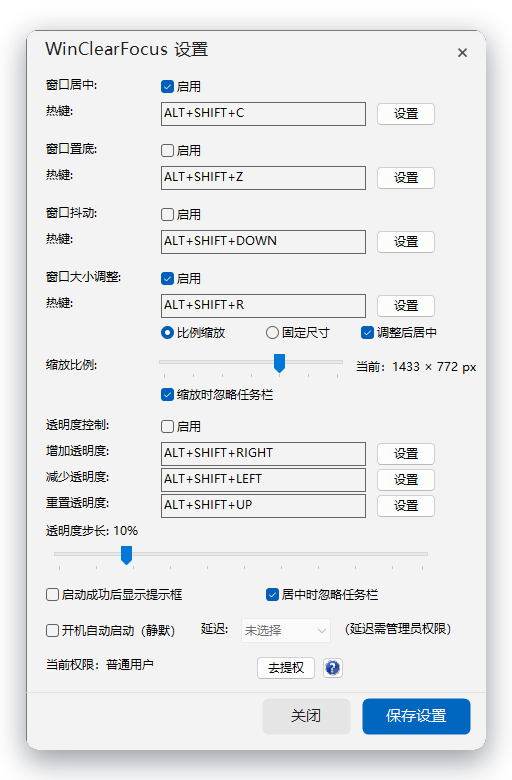
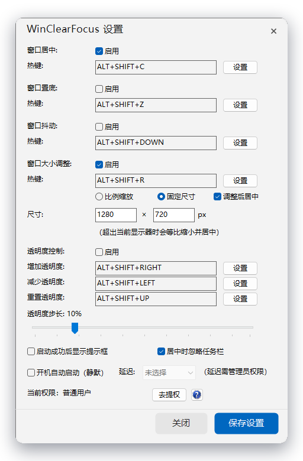

<div align="center">
<!-- 项目图标，默认调用仓库内app.ico，后续可替换GUI截图png -->

</div>
<h1 align="center">WinClearFocus</h1>

<p align="center">一个轻量级的 Windows 窗口辅助工具：调透明度、居中、置底、抖动——全部一个热键搞定。</p>

<p align="center">
  
  
  
  
</p>

WinClearFocus 基于 [iwill123/Window2Clear](https://github.com/iwill123/Window2Clear) 二次开发，使用 **C++ + 纯 Win32 API** 实现，不使用任何第三方 UI 框架。单文件绿色运行、托盘常驻，界面由 GDI+ 自绘并启用 Windows 11 视觉样式。

## 📸 界面预览

<p align="center">
  
  &nbsp;&nbsp;
  
</p>

<p align="center"><sub>设置界面 · 比例缩放 / 固定尺寸</sub></p>

## ✨ 核心特性

- **窗口居中** — 按目标窗口所在显示器的**工作区**居中，自动避开任务栏；多显示器下不会"飞回主屏"；最大化窗口自动跳过。
- **任意窗口透明度** — 以 10% 为步长调整当前前台窗口，最低可到 **1%**（近乎全透明）。
- **一键重置透明度** — 调"没了"也不用慌，一个热键立刻恢复不透明。
- **窗口抖动** — 让当前窗口"抖一抖"，提醒走神的自己。
- **窗口置底** — 把当前窗口压到所有窗口最底层（摸鱼神器）。
- **快捷调整窗口大小** — 一个热键把当前窗口缩放成屏幕的百分比或指定宽高，自动居中；拖动设置里的滑块时有**虚线预览框**实时框出目标区域。
- **系统托盘 + 全局热键** — 常驻托盘，热键全局响应，设置自动保存。

## 🚀 进阶功能

### 静默启动

支持命令行参数静默进入托盘，不弹启动提示：

```
WinClearFocus.exe -silent
```

也可以通过 `config.ini` 的 `ShowStartupMessage=0` 永久关闭启动提示（优先级：命令行 > 配置文件）。

### 智能开机自启

设置界面里的"开机自动启动（静默）"会**根据当前权限自动选择最合适的实现**：

| 当前权限 | 实现方式 | 延迟启动 |
| --- | --- | --- |
| 普通用户 | 注册表 `HKCU\Software\Microsoft\Windows\CurrentVersion\Run` | 不支持（下拉框自动置灰） |
| 管理员 | 计划任务 `\WinClearFocus\WinClearFocus`（登录触发、最高权限运行） | 支持 5 / 10 / 15 / 30 秒 |

细节：

- 管理员方式创建任务前会**无条件清理同名残留任务**，避免旧参数冲突；
- 任务创建成功后会**删除注册表启动项**，杜绝双重启动；
- 关闭自启时两处都会清理，失败会给出明确提示；
- 延迟通过 `schtasks /delay 0000:15` 传入（分:秒格式）。

### 窗口大小调整

`Alt + Shift + R` 把当前窗口调整为：

- **比例缩放**（默认 70%）—— 按窗口所在显示器的**工作区**等比缩放，可勾选"缩放时忽略任务栏"；
- **固定尺寸**（默认 1280 × 720）—— 输入 100–8000 px 的宽高；若超出当前显示器，会**等比缩小直到放得下**；
- 两种模式都默认**调整后居中**（取消勾选则保持原左上角位置不变）；
- 最大化 / 全屏窗口会被自动跳过。

在设置界面拖动滑块或修改宽高时，会在对应显示器上弹出**虚线预览框**（置顶、鼠标穿透），停止操作 0.5 秒后自动消失。

> **为什么用快捷键改过的尺寸，程序重启后不保留？**
> 窗口尺寸通常由目标程序自己"记住"：它收到鼠标拖拽 / 最大化产生的 `WM_MOVE` / `WM_SIZE` 时，会把当前尺寸写回自己的注册表或配置文件。我们通过 `SetWindowPos` 从外部修改属于"临时改动"，很多程序不会把它当成需要持久化的状态。这属于目标程序自身的机制，本工具无法干预其他程序的配置。

## ⌨️ 默认快捷键

| 功能 | 默认快捷键 | 默认启用 |
| --- | --- | --- |
| 窗口居中 | `Alt + Shift + C` | ✅ |
| 窗口大小调整 | `Alt + Shift + R` | ❌ |
| 透明度增加 | `Alt + Shift + →` | ❌ |
| 透明度减少 | `Alt + Shift + ←` | ❌ |
| 重置透明度 | `Alt + Shift + ↑` | ❌ |
| 窗口抖动 | `Alt + Shift + ↓` | ❌ |
| 窗口置底 | `Alt + Shift + Z` | ❌ |

> 热键均可自定义：设置界面点击对应"设置"按钮后直接按下新的组合键即可。**开箱即用只启用"窗口居中"**，其余功能按需在设置里勾选"启用"（保存后生效），避免误触。

## 🖱️ 使用方法

1. 双击 `WinClearFocus.exe`，程序进入系统托盘（首次启动会有提示框，可用 `-silent` 跳过）；
2. 切换到任意窗口，按下热键即可对该窗口生效；
3. **右键点击托盘图标 → 设置**，可以自定义热键、启用功能、调整透明度步长、配置开机自启。

## 🛠️ 编译与构建

### 环境要求

| 项目 | 要求 |
| --- | --- |
| 操作系统 | Windows 10 / 11 |
| CMake | 3.20+（开发时使用 4.3） |
| 构建工具 | **Ninja**（推荐，比 MinGW Makefiles 更快） |
| 编译器 | **强烈推荐 [MSYS2](https://www.msys2.org/) UCRT64 工具链**（自带完整的静态库，可产出无 DLL 依赖的单文件 exe） |

> ⚠️ 不建议使用 CLion 自带的 MinGW 15.2：它的静态 `libwinpthread.a` 混用了 UCRT 符号，开启 `-static` 后会在链接阶段报 `__intrinsic_setjmpex` / `__ms_vsnprintf` 未定义。请改用 MSYS2 UCRT64。
>
> 由于链接参数（`-static`、`-static-libstdc++` 等）是 GCC 专有选项，本项目不再提供 MSVC（Visual Studio）构建方式。

### 使用 MSYS2 UCRT64 + Ninja 构建

```bash
cmake -S . -B build -G Ninja \
      -DCMAKE_CXX_COMPILER=C:/msys64/ucrt64/bin/g++.exe \
      -DCMAKE_RC_COMPILER=C:/msys64/ucrt64/bin/windres.exe
cmake --build build
```

在 CLion 中更简单：`Settings → Build, Execution, Deployment → Toolchains` 新增一个 MinGW 工具链，Toolset 选择 `C:\msys64\ucrt64`；再到 `CMake` 设置里把当前 Profile 的 Toolchain 换成它，Reload 即可。

### 静态编译说明

本项目在 `CMakeLists.txt` 中默认开启了 `-static -static-libgcc -static-libstdc++`：**生成的 exe 文件自带 C++ 运行库与 winpthread，无需任何 DLL 即可在纯净 Windows 环境下双击运行**，不会再出现缺少 `libgcc_s_seh-1.dll`、`libstdc++-6.dll` 的问题。

产物位于 `build/WinClearFocus.exe`，体积约 800 KB（已包含多尺寸图标与内嵌 manifest）。

> 可执行文件内嵌了 **comctl32 v6 manifest**，因此复选框、输入框、滑杆等原生控件会自动使用系统视觉样式；窗口圆角依赖 Windows 11 的 DWM，Win10 上会退化为直角（不影响功能）。

## 📝 配置文件

程序所在目录（与 exe 同级）下的 `config.ini` 保存全部设置，首次运行会自动生成；无论从哪个工作目录启动，读写都指向 exe 同级的配置文件。也可以手工编辑后再启动。

### `[Settings]`

| 键 | 默认值 | 说明 |
| --- | --- | --- |
| `TransparencyStep` | `10` | 透明度调整步长（1–50，单位 %） |
| `ShowStartupMessage` | `1` | 启动时是否弹提示框（0 = 静默） |
| `CenterIgnoreTaskbar` | `1` | 居中时是否忽略任务栏（使用工作区） |
| `AutoStartDelay` | `0` | 开机自启延迟秒数（0 / 5 / 10 / 15 / 30，仅管理员有效） |
| `RegulateMode` | `0` | 窗口大小调整模式：`0` = 百分比缩放，`1` = 固定宽高 |
| `RegulateScale` | `70` | 百分比模式缩放比例（30–90，步长 5） |
| `RegulateIgnoreTaskbar` | `1` | 百分比模式是否忽略任务栏（1 = 按工作区缩放） |
| `RegulateWidth` | `1280` | 固定模式宽度（100–8000 px） |
| `RegulateHeight` | `720` | 固定模式高度（100–8000 px） |
| `RegulateCenter` | `1` | 调整后是否居中（0 = 保持原左上角不动） |

### `[Hotkeys]`

每组功能由 `Modifiers`（修饰键位掩码）和 `Key`（虚拟键码）组成：

| 键 | 说明 |
| --- | --- |
| `TransparencyUpModifiers` / `TransparencyUpKey` | 增加透明度 |
| `TransparencyDownModifiers` / `TransparencyDownKey` | 减少透明度 |
| `ResetTransparencyModifiers` / `ResetTransparencyKey` | 重置透明度 |
| `CenterModifiers` / `CenterKey` | 窗口居中 |
| `ShakeModifiers` / `ShakeKey` | 窗口抖动 |
| `SendToBottomModifiers` / `SendToBottomKey` | 窗口置底 |
| `RegulateModifiers` / `RegulateKey` | 窗口大小调整（默认 `5` / `82` = `R`） |

修饰键掩码：`MOD_ALT = 1`、`MOD_CONTROL = 2`、`MOD_SHIFT = 4`、`MOD_WIN = 8`，可相加（例如 `5` = Alt + Shift）。
按键使用 Windows 虚拟键码，例如 `C = 67`、`Z = 90`、`VK_UP = 38`、`VK_RIGHT = 39`。

### `[Switches]`

| 键 | 默认值 | 说明 |
| --- | --- | --- |
| `EnableTransparencyUp` | `0` | 启用透明度增加 |
| `EnableTransparencyDown` | `0` | 启用透明度减少 |
| `EnableResetTransparency` | `0` | 启用重置透明度 |
| `EnableCenter` | `1` | 启用窗口居中 |
| `EnableShake` | `0` | 启用窗口抖动 |
| `EnableSendToBottom` | `0` | 启用窗口置底 |
| `EnableRegulate` | `0` | 启用窗口大小调整 |

## 📁 项目结构

```
WinClearFocus/
├── CMakeLists.txt
├── README.md
├── docs/
│   └── screenshot.png
└── WinClearFocus/
    ├── WinClearFocus.cpp        # 全部逻辑（托盘、热键、设置界面、自启）
    ├── WinClearFocus.rc         # 图标与 manifest 资源
    ├── WinClearFocus.manifest   # comctl32 v6 视觉样式
    ├── resource.h
    ├── WinClearFocus.ico
    └── config.ini               # 默认配置模板
```

## 🙏 致谢

- 特别感谢原作者 **[iwill123](https://github.com/iwill123)** 的 **[Window2Clear](https://github.com/iwill123/Window2Clear)**，本项目正是在它的基础上二次开发而来；
- 感谢所有提出 Issue 和使用反馈的朋友。

## 📄 许可证

本项目沿用原项目的开源方式发布，欢迎提交 Issue 与 Pull Request。
